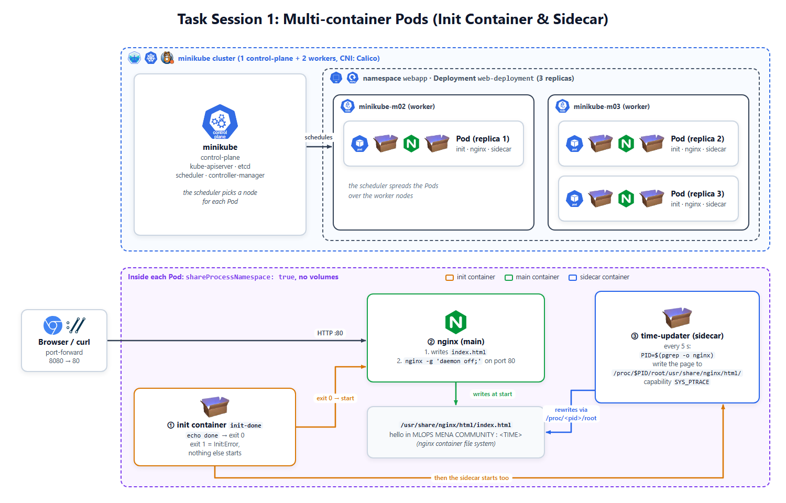

# 🧪 Task Session 1: Multi-container Pods (Init Container & Sidecar)

## 📝 Description

Run a "hello" page with nginx on a 3-node minikube cluster. The page shows the current time:

```text
hello in MLOPS MENA COMMUNITY : 2026-10-15 10:15:05
```

Each Pod has three containers and **no volume**:

| Container | Type | Job |
|-----------|------|-----|
| `init-done` | Init container | Prints `done` and exits. The other containers start only if it succeeds. |
| `nginx` | Main container | Writes `index.html` with the time, then serves it on port 80 |
| `time-updater` | Sidecar | Rewrites `index.html` with the new time every 5 seconds |

At the end, you make the init container **fail** and see how Kubernetes reacts.

---

## 🧩 Diagram



- The Pod uses `shareProcessNamespace: true`, so the sidecar sees the nginx process.
- The sidecar writes into the nginx container through `/proc/<nginx-pid>/root`.

---

## 🧰 What You Need

- **Tools:** `minikube`, `kubectl`, Docker (minikube driver), a machine with **8 GB RAM** is enough (tested: about 4 GB used at the peak, with 3 MySQL servers and Argo CD)
- **Names:**

| Resource | Name |
|----------|------|
| Namespace | `webapp` |
| Deployment / Pod label | `web-deployment` / `app: web` |
| Containers | `init-done`, `nginx`, `time-updater` |
| Images | `busybox:1.36` (init + sidecar), `nginx:1.27` |

---

## 🚀 Steps

### 1. Create the cluster

- Start a cluster with **1 control-plane + 2 workers**.
- Use the **Calico** network plugin: Task 3 needs it, and all tasks use this cluster.
- 💡 `--memory` is **per node** (3 × 2200 MB). It is a limit, not a reservation.
- 💡 On Linux, run minikube as a normal user in the `docker` group, not as root: `sudo usermod -aG docker $USER`, then log out and in again.

```bash
minikube start --nodes 3 --cni=calico --cpus 2 --memory 2200
kubectl get nodes              # check: 3 nodes Ready
```

### 2. Create the namespace

- Create the namespace `webapp` (YAML or imperative).

### 3. Write the Deployment

- Name `web-deployment`, namespace `webapp`, **3 replicas**, Pod label `app: web`.
- No `volumes`. Set `shareProcessNamespace: true` in the Pod spec.
- **Init container** `init-done` (`busybox:1.36`), success command:

  ```yaml
  command: ["sh", "-c", "echo done"]
  ```

- **Main container** `nginx` (`nginx:1.27`, port 80): override the command with a shell (`/bin/sh -c`) that:
  - writes `<h1>hello in MLOPS MENA COMMUNITY : <TIME></h1>` to `/usr/share/nginx/html/index.html` (use `$(date '+%Y-%m-%d %H:%M:%S')`)
  - then starts nginx in the foreground: `nginx -g 'daemon off;'`

- **Sidecar** `time-updater` (`busybox:1.36`): runs this loop, with the capability `SYS_PTRACE` (`securityContext.capabilities.add`):

  ```sh
  while true; do
    PID=$(pgrep -o nginx)
    if [ -n "$PID" ]; then
      echo "<h1>hello in MLOPS MENA COMMUNITY : $(date '+%Y-%m-%d %H:%M:%S')</h1>" \
        > /proc/$PID/root/usr/share/nginx/html/index.html
    fi
    sleep 5
  done
  ```

> 💡 `kubectl create deployment web-deployment --image=nginx:1.27 --replicas=3 -n webapp --dry-run=client -o yaml > deployment.yaml` gives you a starting file. It sets the label `app: web-deployment`: change it to `app: web` in **both** `selector.matchLabels` and the Pod template labels.
>
> 💡 `shareProcessNamespace` goes in the Pod spec (next to `containers`), not inside a container.

### 4. Deploy and check

```bash
kubectl apply -f deployment.yaml
kubectl get pods -n webapp -w                 # wait for 2/2 Running (Ctrl+C to stop)
kubectl port-forward -n webapp deploy/web-deployment 8080:80   # keeps running: use a second terminal
```

- Open <http://localhost:8080>. Refresh after 5 seconds: the time changes.

### 5. Make the init container fail

- Change only the init container command so it exits with code **1**:

  ```yaml
  command: ["sh", "-c", "echo 'init failed'; exit 1"]
  ```

- Apply the file again (don't delete the Deployment) and watch the new Pod:

  ```bash
  kubectl apply -f deployment.yaml
  kubectl get pods -n webapp -w
  kubectl logs <new-pod> -n webapp -c init-done
  kubectl describe pod <new-pod> -n webapp
  kubectl rollout status deploy/web-deployment -n webapp   # waits (up to 10 min): Ctrl+C to stop
  ```

- Answer: Which status does the new Pod show? Do `nginx` and `time-updater` start? Is the page still reachable, and why?

### 6. Fix it

- Get all 3 Pods running again with the working init command.
- 💡 The new Pod stays in `Init:CrashLoopBackOff` until the Deployment goes back to a working version.

---

## 🔍 Verify

| # | Check | Command | Expected result |
|---|-------|---------|-----------------|
| 1 | 3 nodes | `kubectl get nodes` | `minikube`, `minikube-m02`, `minikube-m03` are `Ready` |
| 2 | Deployment ready | `kubectl get deploy web-deployment -n webapp` | READY `3/3` |
| 3 | Pods running | `kubectl get pods -n webapp -l app=web` | 3 Pods, each `2/2 Running` |
| 4 | Containers | `kubectl get pods -n webapp -l app=web -o jsonpath='{.items[0].spec.initContainers[*].name} {.items[0].spec.containers[*].name}'` | `init-done nginx time-updater` |
| 5 | Init succeeded | `kubectl logs deploy/web-deployment -n webapp -c init-done` | `done` |
| 6 | Sidecar sees nginx | `kubectl exec deploy/web-deployment -n webapp -c time-updater -- ps` | `nginx: master process` in the list |
| 7 | Time updates | `kubectl exec deploy/web-deployment -n webapp -c nginx -- cat /usr/share/nginx/html/index.html` (twice, 5 s apart) | `hello in MLOPS MENA COMMUNITY : ...` with a new time |
| 8 | No volumes | `kubectl get deploy web-deployment -n webapp -o jsonpath='{.spec.template.spec.volumes}'` | Empty |
| 9 | Failing init (Step 5) | `kubectl get pods -n webapp -l app=web` | New Pod `Init:Error` → `Init:CrashLoopBackOff`, READY `0/2`; the 3 old Pods stay `2/2 Running` |
| 10 | Init error details (Step 5) | `kubectl describe pod <new-pod> -n webapp` | `init-done`: `Exit Code: 1` |
| 11 | Fixed (Step 6) | `kubectl get deploy web-deployment -n webapp` | READY `3/3`, UP-TO-DATE `3` |

> ℹ️ READY shows `2/2`: the init container has finished, so only `nginx` and `time-updater` count.

---

## 🧹 Clean Up (optional)

Keep the cluster for Task 2. Remove this task's namespace:

```bash
kubectl delete namespace webapp
```

---

## 📤 Submission

To submit your task:

1. **GitHub Repository:** Create a single GitHub repository named **`Kubernetes Course Tasks`** under your GitHub account to host all course tasks.
2. **Task Folder:** Create a folder named **`Task-1`** inside this repository and place all the files and manifests you used to complete this task inside it.
3. **README with Screenshots:** Include a `README.md` file inside the `Task-1` folder documenting what was done, along with screenshots showing the commands run and the verification results.
