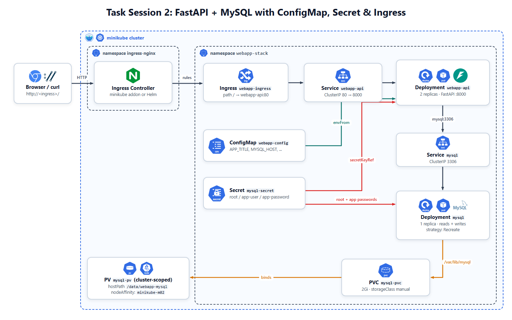
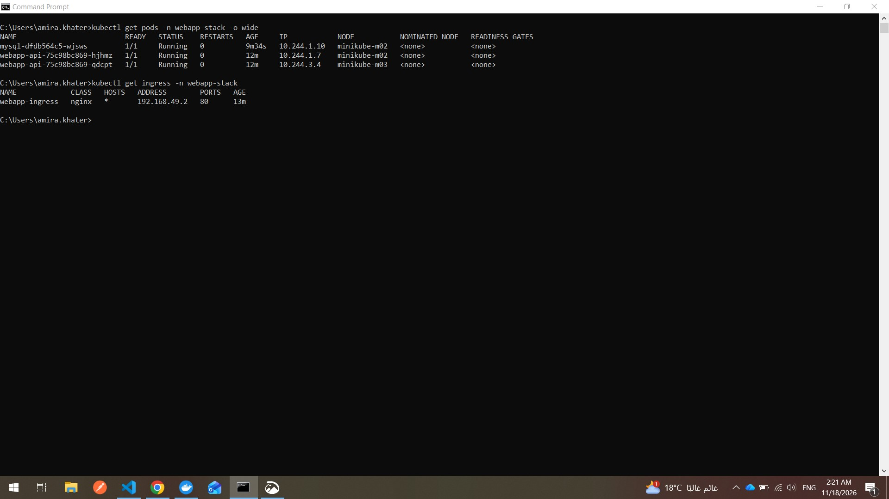
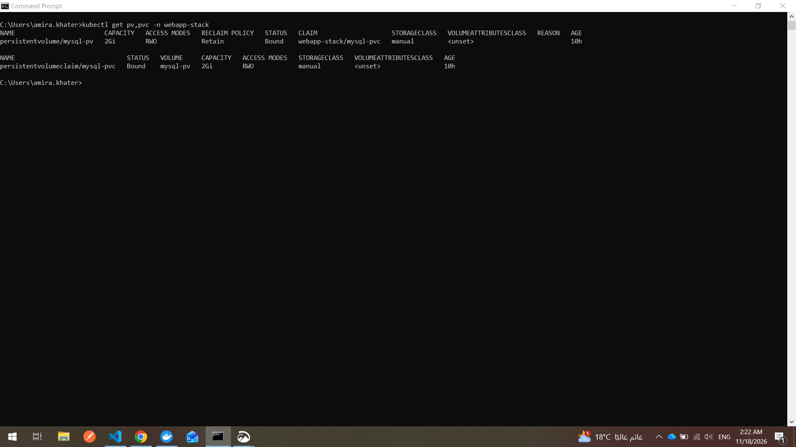
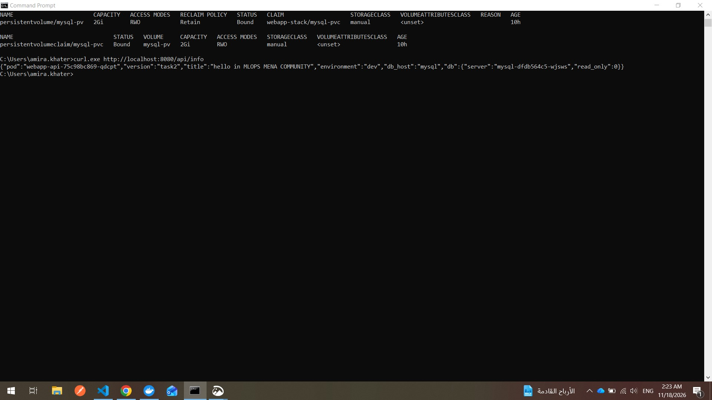
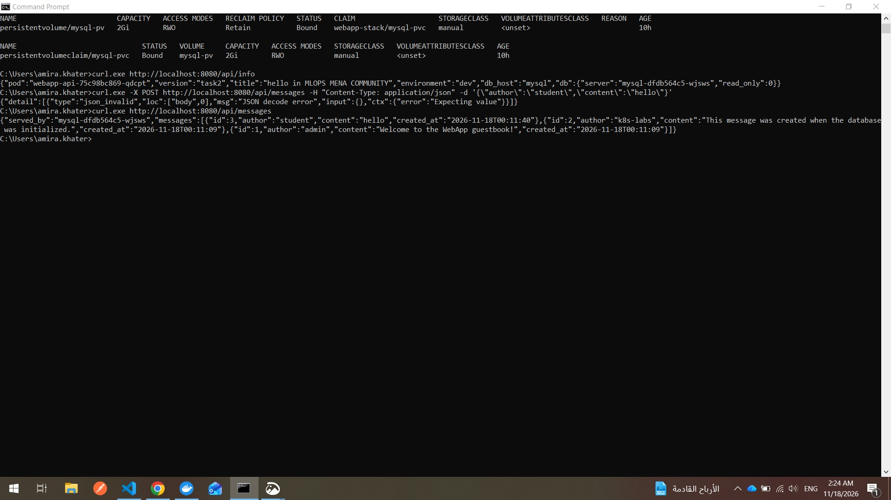
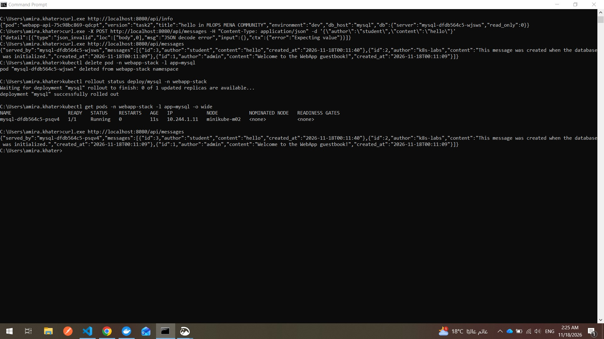

# Task 2: FastAPI + MySQL with ConfigMap, Secret & Ingress

A FastAPI guestbook (`webapp-api`, 2 replicas) backed by one MySQL server on Kubernetes (minikube, 3 nodes). MySQL data lives on a 2Gi `hostPath` PV pinned to `minikube-m02`; configuration comes from a ConfigMap and a Secret; the app is exposed through an NGINX Ingress.



Browser → Ingress Controller → Ingress `webapp-ingress` → Service `webapp-api` (80 → 8000) → 2 app Pods → Service `mysql` (3306) → MySQL Pod → `mysql-pvc` → `mysql-pv` (`/data/webapp-mysql` on `minikube-m02`).

## Files

| File | Content |
|------|---------|
| `k8s/00-namespace.yaml` | Namespace `webapp-stack` |
| `k8s/01-secret.yaml` | Secret `mysql-secret` (`root-password`, `app-user`, `app-password`) |
| `k8s/02-configmap.yaml` | ConfigMap `webapp-config` (`APP_TITLE`, `APP_ENV`, `MYSQL_HOST`, `MYSQL_PORT`, `MYSQL_DATABASE`) |
| `k8s/03-storage.yaml` | PV `mysql-pv` (2Gi, `hostPath`, `nodeAffinity` to `minikube-m02`) and PVC `mysql-pvc` |
| `k8s/04-mysql.yaml` | Deployment `mysql` (1 replica, `Recreate`) and Service `mysql` |
| `k8s/05-webapp.yaml` | Deployment `webapp-api` (2 replicas) and Service `webapp-api` |
| `k8s/06-ingress.yaml` | Ingress `webapp-ingress` (class `nginx`, path `/`) |
| `webapp/`, `mysql/` | App and MySQL image sources |

## Deploy

```bash
# 1. Images
docker build -t webapp-api:task2 ./webapp
docker build -t webapp-mysql:task2 ./mysql
minikube image load webapp-api:task2
minikube image load webapp-mysql:task2

# 2. Ingress controller
minikube addons enable ingress

# 3. Manifests, in order
kubectl apply -f k8s/00-namespace.yaml
kubectl apply -f k8s/01-secret.yaml -f k8s/02-configmap.yaml
kubectl apply -f k8s/03-storage.yaml
kubectl apply -f k8s/04-mysql.yaml
kubectl apply -f k8s/05-webapp.yaml
kubectl apply -f k8s/06-ingress.yaml

# 4. Reach the Ingress controller (keep running)
kubectl port-forward -n ingress-nginx svc/ingress-nginx-controller 8080:80
```

## Design notes

- **Persistent storage:** `mysql-pv` has `storageClassName: manual`, `Retain` reclaim policy, and `nodeAffinity` on `kubernetes.io/hostname = minikube-m02`. A `hostPath` folder exists on one node only, so every MySQL Pod must be scheduled there or it would start with an empty folder.
- **Configuration:** the app gets all ConfigMap keys with `envFrom`, and `MYSQL_USER` / `MYSQL_PASSWORD` from the Secret. MySQL reads its credentials from the Secret and `APP_DB_NAME` from the ConfigMap. `MYSQL_PORT` stays in the ConfigMap so it overrides the `MYSQL_PORT=tcp://...` variable Kubernetes injects for the `mysql` Service.
- **MySQL Deployment:** `strategy: Recreate` so two MySQL servers never share the data folder.
- **Windows note:** the MySQL entrypoint only *sources* the init script when it is not executable. `chmod -x` has no effect on Windows files, so `mysql/Dockerfile` ends with `RUN chmod -x /docker-entrypoint-initdb.d/01-setup.sh`.
- **Passwords changed after first start:** MySQL creates the database and app user only on an empty data folder. If the Secret changes later, delete the Deployment, then run `minikube ssh -n minikube-m02 -- sudo rm -rf /data/webapp-mysql` and re-apply `04-mysql.yaml`.

## Verification

### 1. Pods, Ingress, PV and PVC

```bash
kubectl get pods -n webapp-stack -o wide
kubectl get ingress -n webapp-stack
kubectl get pv,pvc -n webapp-stack
```

Expected: `mysql` `1/1` on `minikube-m02`, `webapp-api` `2/2`, Ingress class `nginx` with an address, PV and PVC `Bound` at `2Gi`.

<!-- screenshot: images/pods-ingress.png -->


<!-- screenshot: images/pv-pvc.png -->

### 2. Ingress access: `/api/info`

```bash
curl.exe http://localhost:8080/api/info
```

Returns `"version": "task2"`, `"title": "hello in MLOPS MENA COMMUNITY"`, `"environment": "dev"`, `"db_host": "mysql"` and the MySQL server name.


<!-- screenshot: images/api-info.png -->

### 3. Ingress access: `/api/messages`

```bash
curl.exe -X POST http://localhost:8080/api/messages -H "Content-Type: application/json" -d '{\"author\":\"student\",\"content\":\"hello\"}'
curl.exe http://localhost:8080/api/messages
```

The POST returns `{"id":3,"written_to":"mysql-..."}`; the GET lists the new message plus the 2 default ones.


<!-- screenshot: images/api-messages.png -->

### 4. Data persistence after deleting the MySQL Pod

```bash
kubectl delete pod -n webapp-stack -l app=mysql
kubectl rollout status deploy/mysql -n webapp-stack
kubectl get pods -n webapp-stack -l app=mysql -o wide
curl.exe http://localhost:8080/api/messages
```

The new Pod has a different name but runs on `minikube-m02` again, and message id 3 (`student` / `hello`) is still returned together with the 2 default messages, because the data is on the PV.


<!-- screenshot: images/after-restart.png -->
